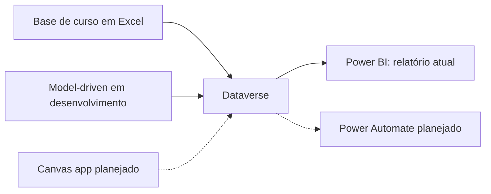

# RH Analytics | Power BI e Power Platform

Projeto de portfólio de GuiSchunck12 para explorar indicadores de recursos humanos e evoluir uma solução integrada de cadastro, análise e automação.

A primeira entrega é um relatório Power BI conectado ao Dataverse. A base utilizada é fictícia, proveniente de material de curso, conforme confirmação do autor. O projeto está em evolução: o aplicativo Model-driven já foi iniciado; Canvas app e Power Automate são próximas etapas.

## Problema de negócio

Centralizar o cadastro de funcionários e facilitar a análise do quadro de pessoal, dos salários e das faltas por filial e departamento.

## Entrega atual

- Arquivo Power BI: [RH_PROJETO_01.pbix](power-bi/RH_PROJETO_01.pbix).
- Referências do relatório à tabela Dataverse `guip_registrodefuncionario`.
- Total de funcionários, salários por filial e departamento, faltas por filial e média de idade por sexo.
- Segmentações por nome, filial, sexo e departamento.

Os indicadores foram identificados na definição do relatório. A atualização da conexão e os valores apresentados precisam ser validados no Power BI Desktop com acesso ao ambiente do autor.

## Arquitetura

## Como explorar

1. Baixe o arquivo `.pbix` da pasta `power-bi` e abra no Power BI Desktop.
2. Explore os visuais e filtros com os dados disponíveis no arquivo.
3. Para atualizar os dados, configure uma fonte Dataverse à qual você tenha acesso e ajuste a conexão no Power Query. A fonte precisa oferecer uma estrutura compatível com a tabela e as colunas utilizadas.

O ambiente Dataverse do autor exige autenticação e permissões. O repositório não concede acesso ao ambiente, ao aplicativo ou ao relatório publicado no Power BI Service.

## Evolução planejada

| Componente | Situação | Próxima entrega |
|---|---|---|
| Power BI + Dataverse | PBIX disponível nesta versão | Validar atualização e adicionar captura do dashboard |
| Model-driven | Iniciado pelo autor | Exportar solução e documentar formulários e permissões |
| Canvas app | Planejado | Construir interface personalizada para RH |
| Power Automate | Planejado | Registrar alcance de meta e notificar uma única vez |
| SQL | Evolução futura | Documentar consultas e integração quando implementadas |

Uma automação candidata é acompanhar a meta anual de 30 contratações por responsável. Antes da implementação, serão definidos o responsável, o período anual, o evento de contratação e o controle de notificações duplicadas. Essa regra ainda não foi implementada.

## Sobre o projeto

Desenvolvido como prática de estudos, com evolução incremental para portfólio. O material de curso é a origem da base; a implementação e as decisões serão documentadas a cada nova entrega. Não são apresentados resultados de produção nem ganhos financeiros mensurados.

Autor: [GuiSchunck12](https://github.com/GuiSchunck12/).
